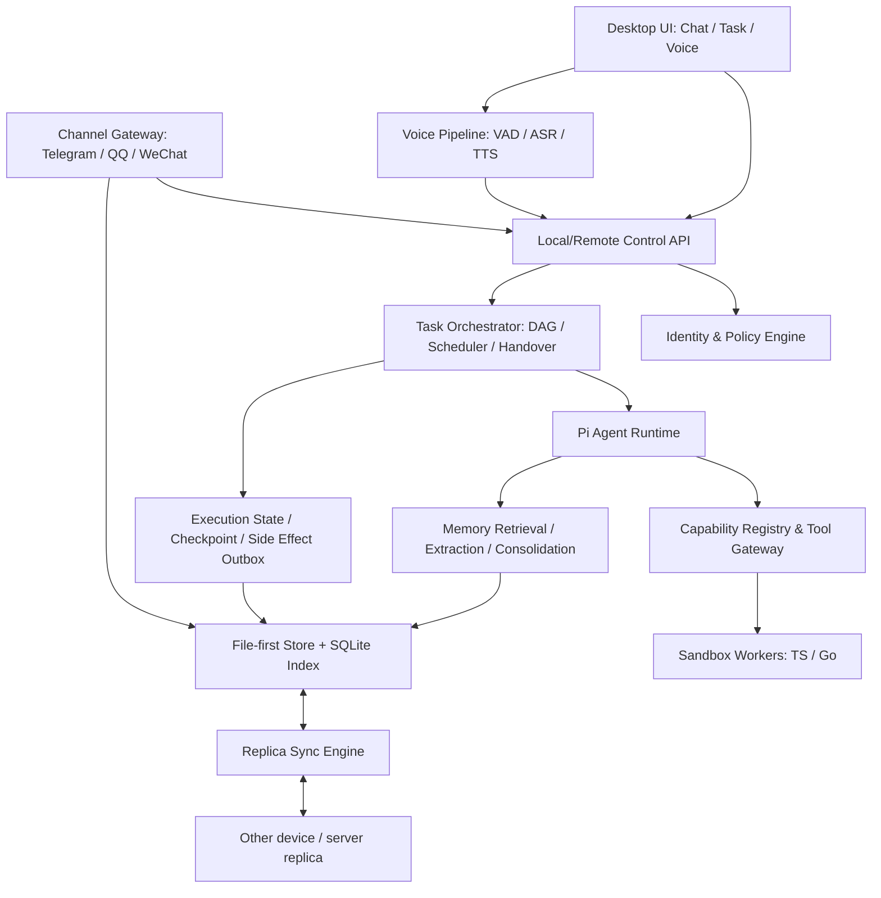

# 可成长个人 Agent — 架构与 MVP 决策稿 V0.6

**状态**：六轮访谈已确认的 PRD 输入基线（不是已实现产品）  
**日期**：2026-10-29  
**目标**：单主人、长期记忆、可自主生成能力、任务可观察和可恢复、跨渠道操作的通用个人 Agent。

## 1. 已确认需求（不得在 MVP 中遗漏）

1. 产品同时覆盖日常个人助手与开发者助手，不做多租户；允许有限权限的可信联系人参与。
2. Agent 内核选择 **Pi**，不再并行选型 DeepSeek Harness。TypeScript/Go 工具混合；首版多云端 LLM，本地 LLM 后续。
3. 桌面端优先，首版 macOS、Windows、Linux 均需通过目标平台验收。
4. 纯本地、纯服务器和本地+服务器混合部署均进入 MVP；混合模式本地优先双向同步，离线可用。
5. 记忆：原始会话保存；前台高价值信息即时写入；后台提取候选并保存来源证据；巩固为长期事实、偏好/用户画像、程序性记忆；自动分层、动态保留；低风险自动更新，重大事实冲突需确认。
6. 自主能力：缺少能力时可生成、测试、注册和执行 Tool/Skill/Plugin；按能力类别预授权、沙箱执行、版本管理；重复经验可以演进为 Skill 和 Tool。
7. 复杂任务：Agent Loop + 动态任务图；多 Agent 按需启用；人类可暂停/修改/接管/恢复；分层展示调用日志、结果和 Diff；Checkpoint + 可补偿外部副作用 + 不可逆标记。
8. 首批渠道：微信、QQ、Telegram；Telegram 官方 Bot 作为稳定基线；微信/QQ 个人账号接入为实验性适配器；后续飞书、钉钉、Discord 等预留接口。
9. 指定联系人/群的白名单读取；群聊可以在平台许可范围内主动发言和回复 @，全部外发消息留审计日志；跨渠道共享任务索引但保留原始会话；可信联系人不能访问主人的私人记忆、文件或开发环境。
10. 实时、可打断语音；本地/云端 ASR、TTS 可选；按回答类型决定语音摘要/完整播报；语音转写实时显示；跨设备通知按任务、事件和渠道设置。

**MVP 的八个能力域全部保留**：记忆、能力工厂、任务工作台、三渠道、实时语音、三种部署与双向同步、Skill/Tool 进化与动态多 Agent、通知/可信联系人/群聊。

## 2. 产品架构与工程选型

| 层 | 推荐技术 | 原因与边界 |
|---|---|---|
| 桌面 UI | Tauri 2 + React/TypeScript（建议、待验证） | 三系统桌面壳、可使用 sidecar；需验证 Node/音频组件的多平台打包与签名；Electron 作为回退方案 |
| Agent | Pi SDK / Pi Agent Core | LLM、Loop、Tool calling、流式事件；使用固定版本及兼容层，禁止业务模块直接耦合不稳定 API |
| 后端 Runtime | Node.js + TypeScript（本地 sidecar、服务器同一应用） | 与 Pi 生态集成；本地/服务器共享调度、记忆、能力与网关逻辑 |
| Go 组件 | 按需独立进程 | 系统级适配、性能敏感服务和 CLI 工具；通过 JSON-RPC/stdio/HTTP 统一调用 |
| 数据层 | SQLite + 原始 JSONL/文件 + Markdown 投影 + 附件目录 | SQLite 文件保存事务事件及元数据，Markdown 用于可读/可编辑记忆；同步传逻辑事件，不复制正在使用的 DB 文件 |
| 记忆检索 | SQLite FTS5 + 按需语义索引（待验证） | 先做来源可追溯的全文检索，必要时再增加嵌入模型 |
| 语音 | sherpa-onnx 候选 + 云端 Provider API | ASR/TTS/VAD 统一抽象；实际模型须验证语言、延迟、体积和许可证 |
| 执行隔离 | 容器或经验证的 OS 沙箱 Worker | 动态生成 TS/Go 不允许直接作为高权限 Pi Extension 加载；无可用隔离执行环境时禁用新代码执行 |
| 跨设备 | TLS API + 设备身份 + 事件增量同步 | 本地优先；重连后增量合并、冲突检查、逐设备确认进度 |

> 选型说明：Tauri、SQLite/FTS5、容器实现是本稿的工程建议，不是第六轮由用户明确指定的不可变技术栈。Pi 与三系统支持、双向同步、八大能力域才是已确认的产品要求。

## 3. 核心领域实体

- `OwnerIdentity` / `ContactIdentity`：主人、可信联系人、所属平台身份和验证记录；不采用多租户架构。
- `Device` / `Replica`：本地设备、服务器实例，持有独立设备密钥、同步游标、可访问资源声明。
- `ChannelAccount` / `Conversation` / `Message`：平台、账号、原始会话和消息映射；原始记录保留来源及权限上下文。
- `Session`：一个 Agent 对话上下文；不等同于 `Task` 或 `Conversation`。
- `Task` / `TaskNode` / `TaskEdge` / `Run`：稳定任务 ID、任务 DAG 及执行实例；一个任务可关联多个会话/渠道。
- `ExecutionEvent`：工具开始/结束、调度、暂停、用户接管、失败、恢复等不可变事件。
- `Checkpoint` / `ArtifactVersion` / `SideEffectRecord`：可恢复的状态、文件快照版本和外部副作用状态。
- `MemorySource` / `MemoryCandidate` / `MemoryFact` / `MemoryRevision`：来源证据、候选、结构化事实及其有效期和版本。
- `Capability` / `CapabilityVersion` / `Skill` / `PermissionGrant`：自主生成的能力和执行边界。
- `NotificationRule` / `OutboundMessageLog`：推送规则及所有外发消息的状态审计。

每条持久化事件至少包含 `event_id`, `replica_id`, `actor_id`, `task_id?`, `session_id?`, `event_type`, `occurred_at`, `causation_id?`, `schema_version`, `payload`, `integrity_hash`。外发副作用还应记录 `idempotency_key`、渠道回执以及“未知是否已送达”状态。

## 4. 记忆机制与双向同步

### 4.1 记忆处理流水线

`Conversation/Task Event -> 即时 Memory Tool（符合高价值规则） -> 原始记录 -> 后台 Extraction -> 候选+证据 -> Consolidation -> 长期事实/画像/Procedural Memory -> 按需检索 -> 新会话`

- 候选记忆默认带来源、发生时间、观察时间、有效区间、置信度、敏感等级和版本。
- 正常偏好冲突可以自动更新并保留历史；重要事实、被锁定信息或敏感冲突进入待确认队列。
- Procedural Memory 保存经验；经测试的 Skill 才成为正式能力。Skill 可调用经过验证的 Tool。
- 用户可导出和编辑 Markdown 记忆文件；人工编辑通过受控导入转换为版本化修改事件，不能绕过冲突检测。
- 原始对话历史和长期记忆分别设置保留/归档/删除规则；删除须经同步删除标记传播，不能因为离线副本恢复而“复活”。

### 4.2 同步协议（首版）

- 每个节点有本地 SQLite 事件账本；用 `(replica_id, sequence)` 和唯一 `event_id` 做增量上传/拉取与幂等去重。
- 同步单元是事件、记忆修订和受控附件引用；**不直接同步活跃的 SQLite 数据库文件**。
- 会话和执行日志只追加、保留来源；同时更新同一长期事实时根据权限、版本和事实有效期执行冲突合并；敏感重大冲突需主人确认。
- 笔记的低风险自动合并不可扩展成对所有二进制文件的 CRDT 同步；文件发生竞争写入时保留两个版本并提示。
- **执行权单点化**：同一 Task Run 在任一时刻只能由一个 Runtime 持有运行租约和 fencing token；跨节点可转移执行权，但不能并行自动重放副作用。
- 离线时可继续本地任务，重连后合并进度；发现两台设备产生独立冲突执行，不自动假装某一条可安全覆盖，应转入 `needs_reconcile`。
- 首版目标是在线增量和离线重连后的基础同步；复杂全自动多主冲突合并延期。

## 5. 自主能力工厂（Capability Factory）

1. 能力检索：优先查找现有 Tool、Skill 和 MCP，避免重复造轮子。
2. 能力规划：生成 Tool/Skill 说明、参数 schema、依赖声明、最小权限 manifest、测试用例。
3. 代码构建：TypeScript 或 Go，依赖锁定、包版本固定、禁止未经许可访问主机敏感资源。
4. 隔离验证：在独立 Worker/容器中运行单元、正反向、资源越权和故障测试。
5. 注册：可信 Tool Gateway 注册稳定接口；AI 生成代码作为沙箱 Worker 运行，**不得自动载入高权限 Pi Extension**。
6. 使用与演进：收集可验证的成功与失败案例；版本化更新、降级、禁用、回滚。
7. 权限：按文件范围、网络目标、Shell 命令类别、消息渠道、凭据使用等维度预授权；任何新 Tool 的权限不得超过事先授予的范围。

**必须明确的安全语义**：允许 AI 自主创建和安装，不等于允许它自己扩大授权。所有 Tool 输入须经过 schema 校验和策略检查；不可信输出进入模型前应标记来源和隔离信任级别。

## 6. 任务编排、用户介入和恢复

- 简单任务：单 Agent Loop；复杂任务：动态 DAG + 调度器 + Worker。只有可并行且资源不冲突的节点才委托给多个 Agent。
- 任务状态建议：`created -> planned -> running -> (paused | waiting_input | failed | completed | cancelled | needs_reconcile)`。
- 任务节点记录输入/输出工件、依赖、责任 Agent、模型、权限、工作空间和可重试性。
- 可视化分层：默认任务树与关键进度；展开后查看模型决策摘要、工具调用、输入输出、文件 Diff、测试、错误和检查点。
- 用户可暂停、补充上下文、修改未完成节点、调整模型、接管子任务，再交还系统；计划修改需提升任务版本并重算依赖。
- Checkpoint 至少保存：Task Graph/Run 状态、已验证输出引用、文件快照/Worktree 引用、执行配置、模型与工具版本、相关会话 ID、待处理副作用。
- 恢复语义按 `reversible | compensatable | irreversible | delivery_unknown` 分类；对外发送消息、付款、提交表单等不得假称完全原子化。
- 外发消息使用 Outbox 与幂等控制；对无法查询回执且结果未知的操作，不自动重发，应进入人工核对或明确的补偿流程。
- 修改同一项目时可通过 Git Worktree 进行子 Agent 工作区隔离，合并前需要冲突检测；非代码任务使用资源锁或乐观并发校验。

## 7. 平台接入、身份与群聊

- 首批 `ChannelAdapter`：Telegram 官方 Bot（稳定）、QQ（官方 Bot 能力+个人号实验研究）、微信个人客户端（实验）。未来飞书、钉钉、Discord 通过同接口接入。
- 统一入站结构：`channel, account, native_message_id, native_conversation_id, sender, mention, attachments, timestamp, permission_context`。
- 平台原始 Conversation 保持独立，Task ID 由中间任务路由关联；歧义时请求主人选择，不以相似语义自动合并两个身份。
- 可信联系人仅允许执行授权的轻量任务，私有记忆、凭据、本地文件、开发工具默认不可访问。
- 群聊默认仅在已授权群和已授权范围内操作；支持 @ 回答、允许的主动消息、完整外发消息审计；平台实际权限、频控及用户可见的机器人身份优先。
- 微信/QQ 本地桌面自动化以实验模块交付：必须由用户明确启用、提示可能的不稳定与账号风险，不得通过规避平台限制承诺“人类账号完整能力”。
- QQ 官方文档指出主动消息能力存在平台限制，不能为所有 QQ 群设计无限制主动发送的验收承诺。

## 8. 实时语音与通知

- Voice Runtime：麦克风输入 -> VAD -> 流式 ASR（转写字幕）-> 会话控制 -> Pi 文字流 -> 语音摘要/全文路由 -> 流式 TTS -> 播放器。
- 本地引擎优先验证 `sherpa-onnx`（可提供 ASR、TTS 和 VAD）；云端使用 ASR/TTS Provider 抽象。
- 用户打断时：立刻停止播放并接收新语音；**不会默认终止正在运行的长任务**。若要暂停任务，需要显式命令或判断授权。
- 通知支持 `completed, failed, waiting_input, milestone`，按任务/渠道配置与去重。跨设备推送不应暴露不属于可信联系人的私人数据。

## 9. MVP 的八个能力域：最低可验收切片

| 域 | MVP 最低交付 | 暂不承诺的成熟度 |
|---|---|---|
| 记忆 | 原始记录、即时存储、异步抽取、候选证据、事实/画像/程序记忆、冲突审核、可检索、基础同步 | 大规模自动知识融合、完全无冲突的多主合并 |
| 能力工厂 | AI 自行生成并验证 1 个 TS Tool、注册调用、版本升级/禁用；Go Worker 通过同接口示范；权限校验和沙箱 | 任意插件安全可信、所有第三方依赖自动兼容 |
| 任务工作台 | 单任务 DAG、工具事件、暂停/调整/接管、Checkpoint 恢复、Diff/副作用状态 | 对所有外部行为实现真正事务回滚 |
| 三渠道 | Telegram 完整 Bot 路径；QQ 官方能力按授权接入并保留个人号实验通道；微信个人号实验性白名单收发链路在明确环境下演示；统一任务关联 | 微信/QQ 全平台稳定、个人聊天全量读取、和人类完全同等群聊权限 |
| 语音 | 实时输入、部分转写、用户插话停止播报、同步文字、本地与云端 ASR/TTS 切换 | 始终在线唤醒、所有设备同等低延迟 |
| 部署同步 | 纯本地、服务器、混合均可启动；离线工作、基础双向记忆/任务事件同步、断线恢复 | 所有文件实时双向合并、完整多主一致执行 |
| Skill/多 Agent | 同类任务经验可生成 Skill 与 Tool；复杂任务至少两个隔离 Worker 并行并合并验证 | 无限制 Agent 蜂群、自主改造内核 |
| 通知/可信联系人/群聊 | 按事件配置通知；主人与一位可信联系人权限区分；Telegram 群 @ 回复与许可的主动消息、外发审计；其他平台按授权能力验收 | 各平台完全一致的群聊行为和自动通知额度 |

**MVP 交付规则**：不能把只保留一个未实现的接口算作完成。对于实验性微信/QQ 适配器，必须交付可配置、可禁用、可诊断的真实功能切片，并在支持的测试环境中完成收发；若平台权限或系统环境阻止演示，必须将该项列为未达成或明确的外部依赖阻塞，而不能直接标注完成。

## 10. 依赖驱动的分阶段路线图（不代表日历承诺）

| 阶段 | 主线工作 | 通过门槛 |
|---|---|---|
| M0：基础设施和威胁模型 | Pi 适配层、UI/Runtime 进程通信、数据 schema、身份及资源权限模型、三 OS CI | 三 OS 启动、基本对话、工具调用及审计事件贯通 |
| M1：任务与记忆单机闭环 | 原始事件、Memory Tool、Extraction/Consolidation、DAG、可视化、Checkpoint | 单机复杂任务可中断恢复；记忆可回溯来源 |
| M2：能力成长闭环 | Tool Factory、TS/Go Worker、容器隔离、自动验证注册、Skill 进化、动态多 Agent | 完成“缺能力 -> 造工具 -> 安全验证 -> 重用”的完整演示 |
| M3：部署与同步 | 本地/服务器打包、复制引擎、设备配对、离线回放、执行租约 | 三种部署均工作；跨设备不重复执行同一任务 |
| M4：社交渠道与权限 | Telegram、QQ/微信实验适配、白名单、主人/可信联系人、群聊、通知 | Telegram 稳定闭环、实验适配链路可实际测试并清晰标记限制 |
| M5：实时语音与工作台整合 | sherpa-onnx/云端切换、打断、字幕、Chat/Task 双视图整合 | 交互完成、语音打断不误杀后台任务 |
| M6：系统联调与首版门禁 | 三 OS 打包、故障注入、安全测试、同步冲突、回滚、文档与自动化验收 | 第 11 节所有强制项达标，未达项目明确为 release blocker |

依赖顺序可按研发资源调整，但 M0（可信事件/权限基础）和 M1（持久任务状态）不得被渠道/语音开发绕过。

## 11. 可验证验收标准

以下数值为 **初始候选阈值**，不是已达到的性能。需在 M0 记录参考硬件、网络、模型和测试数据，基于 M1/M2 原型校准；已确认的“功能验收+量化指标”原则不变。

| 编号 | 验收项 | 可复现方法与初始候选门槛 |
|---|---|---|
| AC-01 | 三系统运行 | macOS、Windows、Linux x64 参考机器均完成安装、启动、退出、重启、一次文本对话和工具调用；核心用例 100% 通过；arm64 范围待定 |
| AC-02 | 多模型切换 | 至少 2 个不同供应商的云端模型可在新任务中切换；失败时不会丢失当前任务或污染已有会话 |
| AC-03 | 记忆可追溯 | 100 条设计好的测试记录中，全部保留原始来源；抽取后的事实能回链到原始事件；敏感冲突不会静默覆盖 |
| AC-04 | 增量双向同步 | 2 个设备各离线新增 50 条独立事件，重连后逐项对账无丢失；参考网络下小事件同步 p95 目标 <=10 秒（待校准） |
| AC-05 | 冲突和删除 | 两节点竞争修改 20 个同一事实，全部产生预期自动合并或待审核状态；已删除记录不会从旧副本静默复活 |
| AC-06 | 自主 Tool Factory | 在 20 组限定需求样例中，从工具生成、沙箱测试到注册运行至少完成 18 组；越权测试 100% 阻断；失败日志可追踪 |
| AC-07 | Checkpoint/恢复 | 对 20 个故障注入点可恢复并验证输出的用例中至少 19 个成功；不可逆操作记录清楚且不得未经确认自动重发未知状态消息 |
| AC-08 | 并行子 Agent | 2 个 Agent 在独立工作区同时执行一个 DAG 的无冲突节点；资源占用冲突时锁/隔离生效；结果合并有验证与记录 |
| AC-09 | Telegram Bot | 私聊、群 @、可信联系人授权、消息外发审计、任务关联各 20 次测试成功（排除平台真实故障并记录重试） |
| AC-10 | 微信/QQ 实验接入 | 各提供适配器配置、权限提示、健康检查、日志、关闭能力，并在声明的一个受支持环境中演示白名单会话实际收发；受权限阻断须列为未达项 |
| AC-11 | 语音可打断 | 参考音频设备和负载下，用户开始打断到播放停止的 p95 目标 <=300ms；实时字幕和本地/云端切换路径通过演示；阈值待校准 |
| AC-12 | 人工介入 | 任务暂停、修改 DAG、切换 Agent、接管和交还各通过至少 5 次端到端用例；所有操作有审计事件 |
| AC-13 | 通知权限 | 完成、失败、待处理按规则通知；重复事件去重；可信联系人不能访问主人私有记忆和文件；越权测试全部阻断 |
| AC-14 | 端到端集成 | 从桌面/Telegram 发起任务 -> 自动创建 Tool -> 记忆更新 -> 子任务运行 -> 用户语音打断 -> 任务继续 -> 跨设备查看 -> 恢复至检查点，全链路可复现并保留轨迹 |

**验收方法补充**：将成功率分成代码自身失败、模型输出不稳定、外部 API 限流/不可用三类；所有分母、模型版本和测试环境固定，避免通过排除失败样本制造虚假达标。

## 12. 风险、未决项和默认方案

| 事项 | 建议默认 | 是否仍待验证 |
|---|---|---|
| 桌面实现 | Tauri 2 + React + Node sidecar，三系统打包失败时评估 Electron | **待原型验证** |
| 目标设备架构 | 首版三系统 x64；Apple Silicon arm64 同期评估 | **待确认** |
| Sandbox | 容器 Worker 优先；无隔离环境时拒绝运行自动生成代码 | **待确定依赖条件** |
| 运行环境是否预装 Docker/Podman | 以可选安装/自动健康检查方式处理，不默认为系统自带 | **待确认** |
| 文件式记忆具体格式 | SQLite 事务事件库 + Markdown 可编辑投影 + 原始 JSONL/附件 | 建议默认，待实现验证 |
| 远程安全 | TLS、设备配对、身份公钥、磁盘加密/密钥库；对云端模型的数据出境须有用户可见设置 | 具体加密和密钥生命周期待确认 |
| 多端冲突 | 首版事件级同步与冲突审核，不承诺任意数据类型自动无损合并 | 已限定首版成熟度 |
| 微信个人号 | 白名单本地自动化实验路线；不保证跨 OS 稳定和账号安全 | **重大外部风险** |
| QQ 个人号/官方机器人 | 官方接口能力与个人号自动化分离；群内主动发送受官方限制 | **重大外部风险** |
| 语音本地模型 | sherpa-onnx 候选，各语言模型单独基准测试 | **待硬件测量** |
| 版本范围 | 首版覆盖 8 个域的薄切片，进阶稳定性与全部渠道延期 | 已确认 |
| 本地 LLM、原生手机应用、多租户、持续唤醒、更多渠道 | 后续迭代，不作为此版验收条件 | 已确认或合理默认 |

## 13. 首版关键用户旅程

**旅程 A：成长式工具创建**：用户要求处理一个从未见过的文档格式 → Agent 检查已有技能/工具 → 生成新 TS/Go Tool → 限权沙箱测试 → 注册能力 → 完成任务 → 记录证据和运行结果 → 后续任务发现并重用。

**旅程 B：长任务接管与恢复**：用户让 Agent 维护项目 → Orchestrator 拆出 DAG → 两个子 Agent 在隔离工作区并行 → 用户发现方向不对，在任务工作台暂停并修改节点 → 系统保存版本和 Checkpoint → 从安全点恢复 → 外发报告的操作记录可审计。

**旅程 C：跨端记忆与渠道**：在本地桌面端告知重要偏好 → 前台 Memory Tool 写入并带来源 → 设备离线保留 → 网络恢复后同步服务器 → 通过 Telegram 查询同一个任务并沿用已允许的记忆 → 可信联系人只能看到被授权的结果。

**旅程 D：实时语音中断**：语音询问复杂任务 → 流式转写和模型回答、TTS 播放 → 主人插话，立即停止播报 → 原任务继续在后台运行 → Voice Runtime 根据当前会话重新回答 → 通知按规则发送。

## 14. 外部参考（用于技术验证，非用户需求来源）

- Pi SDK：https://pi.dev/docs/latest/sdk
- Pi 扩展及权限：https://pi.dev/docs/latest/extensions
- Pi 运行机制：https://pi.dev/docs/latest/how-pi-works
- sherpa-onnx：https://github.com/k2-fsa/sherpa-onnx
- Tauri Sidecar：https://v2.tauri.app/develop/sidecar/
- Telegram Bot API：https://core.telegram.org/bots/api
- Telegram 群隐私模式：https://core.telegram.org/bots/features#privacy-mode
- QQ 机器人官方文档仓库：https://github.com/tencent-connect/bot-docs
- QQ 主动消息限制文档：https://github.com/tencent-connect/bot-docs/blob/main/docs/develop/api-v2/server-inter/message/send-receive/send.md

---

**决策结论**：技术上可构建；主要风险不在 Pi 的 Agent Loop，而在 3 OS 的安全执行隔离、分布式任务的副作用一致性、微信/QQ 账号接入稳定性，以及语音实时性能。建议以以上基线继续编写正式 PRD 的功能条目、界面流程、API 合约和测试用例，不再重新发散产品定位。
