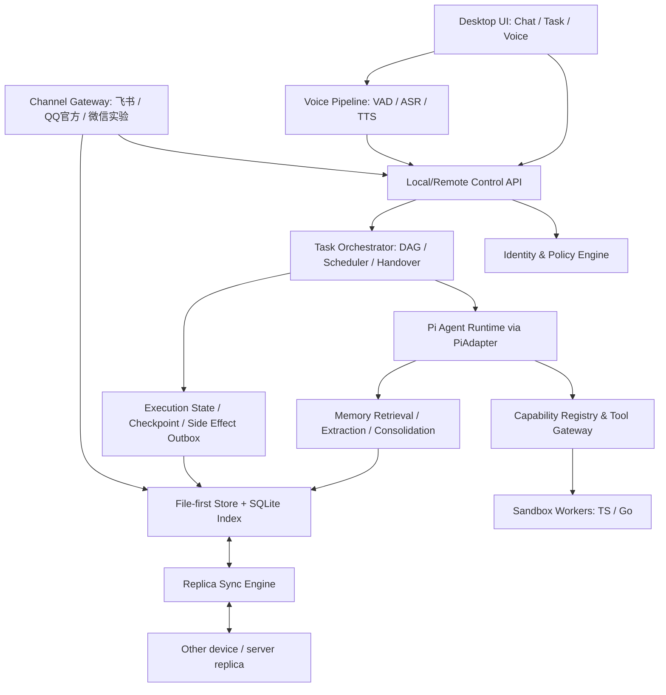

# Morrow PRD v1.0

**状态**：已确认 —— 三轮 grill 访谈完结（2026-10-29），本文件取代决策稿 V0.6 成为唯一需求真相源；V0.6 归档于 `docs/history/decision-baseline-v0.6.md`，两者冲突之处以本文件 + ADR 为准。
**术语**：统一语言见根目录 `GLOSSARY.md`；工程决策见 `docs/adr/`。
**资源基调**：单人业余开发；里程碑只排依赖顺序，不承诺日历。

---

## 1. 产品概述

Morrow 是一个**单主人**的个人 Agent：具备长期记忆、可自主生成能力、任务可观察可恢复、可在多渠道操作，同时服务日常助理与开发者助手两种场景。允许经授权的可信联系人（Trusted Contact）有限参与，但不做任何多租户设计。

**非目标（MVP 范围外）**：多租户、原生手机应用、持续语音唤醒、本地 LLM（协议天然兼容 ollama 等 OpenAI 兼容端点，但不作验收）、Telegram 渠道（接口预留，延后）、任意数据类型的自动无损合并。

## 2. 架构基线



| 层 | 选型 | 依据 |
|---|---|---|
| 桌面 UI | Tauri 2 + React/TypeScript，Electron 回退 | 三平台打包冒烟门见 §5.7 |
| Agent 内核 | Pi（badlogic/pi-mono），版本锁定 + PiAdapter | ADR-0001 |
| LLM 接入 | 仅 OpenAI Chat Completions 兼容协议，`base_url+api_key+model` 三元组，密钥存 OS 凭据库 | ADR-0002 |
| Runtime | Node.js + TypeScript；单二进制打包（bun compile 首选 / Node SEA 回退）；桌面 sidecar 与 Ubuntu 服务器同一代码 | ADR-0003 |
| Go 组件 | 按需独立进程（系统适配/性能敏感/CLI），JSON-RPC/stdio/HTTP 调用 | 决策稿 §2 |
| 数据层 | SQLite（事务事件+索引）+ 原始 JSONL/文件 + Markdown 投影 + 附件目录 | 决策稿 §2 |
| 记忆检索 | SQLite FTS5 先行，语义索引按需后加 | 决策稿 §2 |
| 语音 | sherpa-onnx 候选（本地）+ 云端 Provider 抽象 | 决策稿 §8，待硬件测量 |
| 执行隔离 | 容器 Worker（Linux 原生；macOS Docker Desktop/OrbStack；Windows WSL2+Docker）；无隔离环境时**拒绝执行 AI 生成代码** | 决策稿 §2 + R1-Q7 |
| 传输 | 默认私有网络（Tailscale/WireGuard），公网 ACME 模式预留不验收 | ADR-0004 |

## 3. 领域模型

实体清单与关系以决策稿 §3 为基础（收编为本 PRD 的一部分）：`OwnerIdentity/ContactIdentity`、`Device/Replica`、`ChannelAccount/Conversation/Message`、`Session`、`Task/TaskNode/TaskEdge/Run`、`ExecutionEvent`、`Checkpoint/ArtifactVersion/SideEffectRecord`、`MemorySource/MemoryCandidate/MemoryFact/MemoryRevision`、`Capability/CapabilityVersion/Skill/PermissionGrant`、`NotificationRule/OutboundMessageLog`。定义以 `GLOSSARY.md` 为准；冲突时先修 GLOSSARY 再改代码。

## 4. 功能需求（八大能力域）

优先级：P0 = MVP 必须交付；P1 = MVP 尽力、可降级为明确未达项。

### 4.1 记忆（M1）

| 编号 | 功能 | 描述 | 优先级 | 验收 |
|---|---|---|---|---|
| FR-MEM-1 | 原始记录保存 | 所有 Conversation/Task 事件不可变落库（JSONL + SQLite 索引） | P0 | AC-03 |
| FR-MEM-2 | 即时写入 | 前台 Memory Tool 按高价值规则即时写入候选+来源 | P0 | AC-03 |
| FR-MEM-3 | 后台抽取 | 异步 Extraction 产生 MemoryCandidate，带来源/时间/置信度/敏感等级 | P0 | AC-03 |
| FR-MEM-4 | 巩固 | Consolidation 产出 MemoryFact / 偏好画像 / Procedural Memory，含版本与有效期 | P0 | AC-03 |
| FR-MEM-5 | 冲突处理 | 常规偏好自动更新留历史；重大事实/locked/敏感冲突进待确认队列，不静默覆盖 | P0 | AC-03/05 |
| FR-MEM-6 | Markdown 投影 | 记忆投影为可编辑 Markdown（§6.4 格式），受控导入转为版本化修订事件 | P0 | AC-03 |
| FR-MEM-7 | 检索 | FTS5 全文检索，结果可回链原始事件 | P0 | AC-03 |
| FR-MEM-8 | 保留与删除 | 原始记录与长期记忆分别设保留/归档/删除规则；删除经同步标记传播，离线副本不得复活已删数据 | P0 | AC-05 |

### 4.2 能力工厂（M2）

| 编号 | 功能 | 描述 | 优先级 | 验收 |
|---|---|---|---|---|
| FR-CAP-1 | 能力检索 | 先查现有 Tool/Skill/MCP，避免重复造轮子 | P0 | AC-06 |
| FR-CAP-2 | 能力规划 | 生成 Tool 说明、参数 schema、依赖声明、最小权限 manifest、测试用例 | P0 | AC-06 |
| FR-CAP-3 | 代码构建 | TS（或 Go）生成；依赖锁定、版本固定 | P0 | AC-06 |
| FR-CAP-4 | 隔离验证 | 沙箱内跑单元/反向/越权/故障测试；无沙箱则整体禁用 | P0 | AC-06 |
| FR-CAP-5 | 注册与执行 | Tool Gateway 按 §6.3 manifest 校验（权限 ⊆ PermissionGrant），注册后可调用 | P0 | AC-06 |
| FR-CAP-6 | 演进 | 版本化更新/降级/禁用/回滚；成功失败案例入库 | P1 | AC-06 |
| FR-CAP-7 | 权限预授权 | 按文件范围/网络目标/命令类别/渠道/凭据维度预先授权；新 Tool 不得越界 | P0 | AC-06/13 |

### 4.3 任务工作台（M1）

| 编号 | 功能 | 描述 | 优先级 | 验收 |
|---|---|---|---|---|
| FR-TASK-1 | 任务 DAG | 稳定 Task ID；简单任务单 Loop，复杂任务动态 DAG + 调度器 | P0 | AC-07/08 |
| FR-TASK-2 | 执行事件 | 工具开始/结束、调度、暂停、接管、失败、恢复全量不可变记录 | P0 | AC-14 |
| FR-TASK-3 | 人工介入 | 暂停 / 补充上下文 / 修改未完成节点（升任务版本重算依赖）/ 切换模型 / 接管子任务 / 交还 | P0 | AC-12 |
| FR-TASK-4 | 可视化分层 | 默认任务树+关键进度；展开可见决策摘要、工具调用、I/O、Diff、错误、检查点 | P0 | AC-12 |
| FR-TASK-5 | Checkpoint | 保存 Task Graph/Run 状态、输出引用、文件快照、执行配置、模型与工具版本、待处理副作用 | P0 | AC-07 |
| FR-TASK-6 | 副作用分类 | 按 `reversible/compensatable/irreversible/delivery_unknown` 处理；未知状态不自动重发，进入人工核对或补偿 | P0 | AC-07 |
| FR-TASK-7 | Outbox | 外发消息先落库再投递，幂等键 + 渠道回执 + 审计 | P0 | AC-09/10 |
| FR-TASK-8 | 工作区隔离 | 同项目子 Agent 用 Git Worktree 隔离，合并前冲突检测；非代码任务用资源锁/乐观并发 | P1 | AC-08 |

### 4.4 渠道（M4）

| 编号 | 功能 | 描述 | 优先级 | 验收 |
|---|---|---|---|---|
| FR-CH-1 | 飞书 Bot | 自建应用，长连接事件订阅；私聊+群 @ 回复+许可内主动消息 | P0 | AC-09 |
| FR-CH-2 | QQ 官方 Bot | 官方 API 接入；主动消息按平台限制声明，不做无限发送承诺 | P0 | AC-10 |
| FR-CH-3 | 微信个人号实验 | Windows 声明环境白名单收发；默认关闭、启动风险确认、可配置可禁用可诊断 | P0 | AC-15 |
| FR-CH-4 | QQ 个人号实验 | 实验研究项，仅技术验证，不设验收 | P1 | — |
| FR-CH-5 | 统一入站结构 | `channel/account/native_message_id/native_conversation_id/sender/mention/attachments/timestamp/permission_context` | P0 | AC-09/10 |
| FR-CH-6 | 任务路由 | 平台原始 Conversation 保持独立，Task ID 关联；身份歧义时请求 Owner 选择，禁止语义自动合并 | P0 | AC-14 |
| FR-CH-7 | 外发审计 | 全渠道出站消息留 OutboundMessageLog（状态、回执、重试） | P0 | AC-09/10 |
| FR-CH-8 | Telegram 预留 | 仅 ChannelAdapter 接口预留 | P1 | — |

### 4.5 实时语音（M5）

| 编号 | 功能 | 描述 | 优先级 | 验收 |
|---|---|---|---|---|
| FR-VOI-1 | 语音管线 | 麦克风 → VAD → 流式 ASR（实时字幕）→ 会话控制 → Pi 文字流 → 摘要/全文路由 → 流式 TTS → 播放 | P0 | AC-11 |
| FR-VOI-2 | 打断 | 插话立即停止播报并接收新语音；**不终止后台长任务**（暂停需显式命令） | P0 | AC-11 |
| FR-VOI-3 | 引擎切换 | 本地（sherpa-onnx 候选）与云端 ASR/TTS 可切换 | P0 | AC-11 |

### 4.6 部署与同步（M3）

| 编号 | 功能 | 描述 | 优先级 | 验收 |
|---|---|---|---|---|
| FR-DEP-1 | 三种部署 | 纯本地 / 纯服务器（Ubuntu 单二进制）/ 混合；混合模式本地优先、离线可用 | P0 | AC-01/04 |
| FR-DEP-2 | 设备配对 | 一次性配对码（5 分钟有效）+ 双端指纹确认 + OS 凭据库存密钥；设备可查可撤销 | P0 | AC-04 |
| FR-DEP-3 | 增量同步 | 事件账本按 `(replica_id, sequence)` 增量 + `event_id` 幂等；只同步事件/记忆修订/附件引用，**不复制活跃 DB 文件** | P0 | AC-04 |
| FR-DEP-4 | 执行租约 | 同一 Run 单点执行（租约+fencing token），可转移不可并行重放副作用；双端冲突执行转 `needs_reconcile` | P0 | AC-04/05 |
| FR-DEP-5 | 冲突合并 | 同一事实按权限/版本/有效期合并；文件竞争保留双版本并提示；不承诺任意二进制自动合并 | P0 | AC-05 |

### 4.7 Skill 进化与多 Agent（M2）

| 编号 | 功能 | 描述 | 优先级 | 验收 |
|---|---|---|---|---|
| FR-EVO-1 | 经验→Skill | 同类任务成功经验经测试固化为 Skill，Skill 只调用已验证 Tool | P0 | AC-06 |
| FR-EVO-2 | 动态多 Agent | 仅可并行且资源不冲突的节点委托多 Agent；至少两个隔离 Worker 并行 + 合并验证 | P0 | AC-08 |

### 4.8 通知、可信联系人、群聊（M4）

| 编号 | 功能 | 描述 | 优先级 | 验收 |
|---|---|---|---|---|
| FR-NOT-1 | 通知规则 | 事件类型（completed/failed/waiting_input/milestone）× 目标渠道 × 免打扰时段；去重键 `task_id+event_type` | P0 | AC-13 |
| FR-NOT-2 | 通知通道 | 桌面系统通知 + 稳定基线渠道私信（飞书/QQ）；跨设备通知不暴露非授权人可见数据 | P0 | AC-13 |
| FR-NOT-3 | 可信联系人 | 邀请码绑定渠道身份；授权粒度 = 联系人 × 能力类别（查询问答/任务执行/记忆引用），默认仅查询问答；记忆引用仅放行 public；私人记忆/凭据/文件/开发工具默认不可访问 | P0 | AC-13 |
| FR-NOT-4 | 群聊 | 仅白名单群 + 授权范围；@ 回复与许可内主动消息；全量外发审计；平台实际权限与频控优先 | P0 | AC-09/10 |

## 5. 界面与交互

### 5.1 信息架构

```
Morrow Desktop
├── Chat 视图        （M1）会话列表 / 消息流 / 流式回复 / 渠道来源标记
├── Task 视图        （M1 简版 / M6 完整）任务列表 / DAG 详情 / Diff / 检查点 / 接管控制
├── Voice 视图       （M5）实时字幕 / 打断 / 本地-云端切换
└── 设置
    ├── Provider 与模型  （三元组配置、连通性测试）
    ├── 设备与同步       （配对、设备指纹、撤销、同步状态）
    ├── 权限与记忆审核   （PermissionGrant、候选记忆、冲突队列）
    ├── 能力管理         （Tool/Skill 清单、版本、启停、回滚）
    ├── 渠道管理         （适配器启停、白名单、实验适配风险确认）
    └── 通知规则         （事件类型 × 渠道 × 免打扰）
```

### 5.2 关键流程

1. **设备配对**：已信任设备生成 6 位码 → 新设备输入 → 双端展示设备指纹 → 确认 → 公钥交换入凭据库 → 出现在设备列表。
2. **任务接管**：Task 视图暂停 → 修改未完成节点（任务版本 +1，重算依赖）→ 可切换模型/接管子任务 → 从检查点恢复。
3. **记忆冲突审核**：冲突队列展示新旧事实 + 各自来源 → 选择保留/合并/标记 locked → 生成版本化修订事件。
4. **能力注册审核**：能力工厂产出 manifest + 测试报告 → 展示权限请求与越权测试结果 → Owner 批准 → 注册启用。
5. **可信联系人邀请**：生成一次性邀请码 → 渠道发送 → 对方回复绑定 → Owner 配置授权粒度。
6. **实验适配器启用**：渠道管理中显式开启 → 风险确认弹窗 → 健康检查 → 白名单配置。

### 5.3 交付规则

不能把"只保留一个未实现的接口"算作完成。实验性适配器必须交付可配置、可禁用、可诊断的真实切片；平台权限或环境阻止演示时，该项必须标记**未达成**或**外部依赖阻塞**，不得标完成。

## 6. API 合约

### 6.1 形态

- UI ↔ Runtime：本地 HTTP + JSON；流式事件用 SSE（`GET /v1/sessions/:id/stream`）。
- 跨设备/服务器复用同一 API 面 + 设备鉴权头；渠道适配器与 Go Worker 亦为 API 客户端。
- 所有变更操作产生 ExecutionEvent/审计事件。

### 6.2 端点清单（v1）

| 方法 | 路径 | 说明 |
|---|---|---|
| GET | /v1/health | 健康检查（含沙箱可用性） |
| POST | /v1/pairing/codes | 生成配对码（已信任设备） |
| POST | /v1/pairing/claim | 新设备换取设备凭据 |
| GET/DELETE | /v1/devices | 设备列表 / 撤销设备 |
| GET/POST | /v1/sessions | 会话列表 / 创建 |
| GET/POST | /v1/sessions/:id/messages | 历史 / 发送输入 |
| GET | /v1/sessions/:id/stream | SSE 流式事件 |
| GET/POST | /v1/tasks | 任务列表 / 创建 |
| GET | /v1/tasks/:id | 详情（DAG/状态/版本） |
| GET | /v1/tasks/:id/events | 执行事件（分页） |
| POST | /v1/tasks/:id/{pause,resume,takeover,revise,restore} | 介入操作 |
| GET | /v1/tasks/:id/checkpoints | 检查点列表 |
| GET | /v1/memory/facts | 记忆检索 |
| GET/POST | /v1/memory/candidates[/:id/decide] | 候选队列 / 审核 |
| GET/POST | /v1/memory/conflicts[/:id/resolve] | 冲突队列 / 裁决 |
| POST | /v1/memory/import | Markdown 受控导入 |
| GET | /v1/capabilities | 能力清单 |
| POST | /v1/capabilities/request | 发起能力生成 |
| POST | /v1/capabilities/:id/{enable,disable,rollback} | 生命周期操作 |
| GET/POST/PUT | /v1/notifications/rules | 通知规则 |
| POST | /v1/contacts/invites | 生成邀请码 |
| GET/PUT | /v1/contacts[/:id/grants] | 联系人 / 授权粒度 |
| POST/GET | /v1/sync/{push,pull} | 事件增量同步 |

### 6.3 事件 schema v1 与 Tool manifest v1

**事件信封**（演进规则：只加字段不删改；破坏性变更必须升 `schema_version`；已写入事件永不重写）：

```json
{
  "event_id": "0193...-uuid-v7",
  "replica_id": "device-or-server-uuid",
  "actor_id": "owner | contact:<id> | agent:<id>",
  "task_id": null,
  "session_id": "session-uuid",
  "event_type": "tool.started",
  "occurred_at": "2026-10-29T12:00:00.000Z",
  "causation_id": null,
  "schema_version": 1,
  "payload": {},
  "integrity_hash": "sha256-..."
}
```

外发副作用事件另带 `idempotency_key`、渠道回执与 `delivery_unknown` 状态标记。同步协议按 `(replica_id, sequence)` 增量上传/拉取、`event_id` 幂等去重。

**Tool manifest**（Gateway 注册时校验 `permissions ⊆ PermissionGrant`，超出即拒绝）：

```json
{
  "name": "docx-to-markdown",
  "version": "1.0.0",
  "author": "ai",
  "runtime": "typescript",
  "permissions": {
    "filesystem": ["workspace://input/**"],
    "network": [], "shell": [], "channels": [], "credentials": []
  },
  "input_schema": {"type": "object", "required": ["file"]},
  "output_schema": {"type": "object"},
  "sandbox": {"type": "container", "network": "none", "filesystem": "workspace-only"},
  "tests": ["positive.yaml", "negative.yaml", "privilege-escalation.yaml"],
  "source_hash": "sha256-..."
}
```

### 6.4 记忆 Markdown 投影

```markdown
---
id: mem_0193...
type: fact            # fact | preference | profile | procedural
sensitivity: private  # public | private | locked
confidence: 0.92
valid_from: 2026-10-29
valid_until: null
sources: ["evt_0193...", "evt_0194..."]
created_at: 2026-10-29T12:00:00Z
updated_at: 2026-10-29T12:00:00Z
version: 3
---
Owner 偏好使用 TypeScript 编写脚本工具。
```

人工编辑经受控导入转为版本化修订事件，不绕过冲突检测。

## 7. 安全与威胁模型（M0 交付文档范围）

| 域 | 威胁 | 对策 |
|---|---|---|
| 设备失窃 | 物理访问读取记忆与凭据 | 磁盘加密建议 + OS 凭据库存密钥 + 敏感数据加密落盘 |
| 生成代码逃逸 | AI 生成的 Tool 越权 | 沙箱边界（无沙箱禁用）+ schema 校验 + 权限 ⊆ 授权 + 越权测试 100% 阻断（AC-06） |
| 渠道消息注入 | 渠道来文携带提示注入 | 入站消息标记不可信来源与隔离信任级别，进入模型前不打信任标签（决策稿 §5） |
| 传输中间人 | 同网段伪造设备/服务器 | 配对码 + 设备公钥指纹确认 + 私有网络隧道（ADR-0004） |

**明确不在范围**：供应链投毒的深度防御、物理取证级对抗。

## 8. 验收标准

阈值均为**初始候选**：M0 记录参考硬件/网络/模型/测试数据，M1/M2 校准。成功率分三类统计：代码自身失败、模型输出不稳定、外部 API 限流/不可用；分母、模型版本、测试环境固定，禁止排除失败样本制造达标。

| 编号 | 验收项 | 方法与门槛 |
|---|---|---|
| AC-01 | 三系统运行 | macOS/Windows/Linux x64：安装、启动、退出、重启、一次文本对话+工具调用 100% 通过；arm64 待定 |
| AC-02 | 多供应商切换 | **两个不同 OpenAI 兼容端点**（推荐 DeepSeek + OpenAI 官方，可换第三方）新任务切换；失败不丢任务不污染会话 |
| AC-03 | 记忆可追溯 | 100 条测试记录全部保留来源；事实可回链；敏感冲突不静默覆盖 |
| AC-04 | 增量双向同步 | 2 设备各离线 50 条独立事件重连后逐项对账无丢失；小事件同步 p95 ≤10s（待校准） |
| AC-05 | 冲突和删除 | 20 个竞争事实全部产生预期合并或待审核；已删数据不从旧副本复活 |
| AC-06 | 自主 Tool Factory | 20 组限定需求 ≥18 组走通生成→沙箱测试→注册运行；越权 100% 阻断；失败日志可追踪 |
| AC-07 | Checkpoint/恢复 | 20 个故障注入点 ≥19 个恢复成功；不可逆操作记录清楚；未知状态消息不自动重发 |
| AC-08 | 并行子 Agent | 2 Agent 独立工作区并行无冲突节点；资源冲突时锁生效；合并有验证记录 |
| AC-09 | 飞书 Bot 稳定闭环 | 私聊、群 @、可信联系人授权、外发审计、任务关联各 20 次成功（排除平台故障并记录重试） |
| AC-10 | QQ 官方 Bot 闭环 | 同 AC-09 方法；主动消息按平台限制声明，不做无限发送承诺 |
| AC-10a | （原 AC-10 拆分）QQ 个人号 | 实验研究项，不设验收承诺 |
| AC-11 | 语音可打断 | 参考设备 = MacBook 内置麦+扬声器；打断到停播 p95 ≤300ms（待校准）；字幕与本地/云端切换可演示 |
| AC-12 | 人工介入 | 暂停/修改 DAG/切换 Agent/接管/交还各 ≥5 次端到端通过；全程审计 |
| AC-13 | 通知与权限 | 通知按规则去重送达；可信联系人越权访问 100% 阻断 |
| AC-14 | 端到端集成 | 桌面/渠道发起任务 → 自动建 Tool → 记忆更新 → 子任务并行 → 语音打断 → 跨设备查看 → 检查点恢复，全链路可复现 |
| AC-15 | 微信个人号实验 | Windows 声明环境（最新版微信）演示白名单收发；适配器可配置/禁用/诊断；受权限阻断须列为未达项 |

## 9. 里程碑（依赖序，非日历承诺）

| 阶段 | 主线 | 通过门槛 |
|---|---|---|
| M0 | PiAdapter、UI/Runtime 进程通信、事件 schema v1、身份与权限模型、威胁模型文档、三 OS CI、Tauri 打包冒烟门（开工后第 2-3 周末）、bun 打包验证、验收基线记录 | 三 OS 启动 + 基本对话 + 工具调用 + 审计事件贯通；桌面壳门做出 Tauri/Electron 裁决 |
| M1 | 原始事件、Memory Tool、抽取/巩固、DAG、可视化、Checkpoint | 单机复杂任务可中断恢复；记忆可回溯来源 |
| M2 | Tool Factory、TS/Go Worker、容器隔离、自动验证注册、Skill 进化、动态多 Agent | "缺能力→造工具→安全验证→重用"完整演示 |
| M3 | 本地/服务器打包（Ubuntu .bin + systemd）、同步引擎、设备配对、离线回放、执行租约 | 三种部署工作；跨设备不重复执行同一任务 |
| M4 | 飞书 Bot → QQ 官方 Bot → 微信实验适配、白名单、可信联系人、群聊、通知（前置：飞书自建应用注册、QQ 机器人资质注册） | 飞书稳定闭环、QQ 官方闭环、实验适配真实可测且限制清晰 |
| M5 | sherpa-onnx/云端切换、打断、字幕、Chat/Task 整合 | 语音打断不误杀后台任务 |
| M6 | 三 OS 打包、故障注入、安全测试、同步冲突、回滚、文档与自动化验收 | §8 全部强制项达标，未达项明确为 release blocker |

M0（事件/权限基础）与 M1（持久任务状态）不得被渠道/语音开发绕过。

## 10. 风险与未决项

| 事项 | 状态 |
|---|---|
| Tauri 2 三平台打包 + sidecar + 音频 | 待 M0 冒烟门验证；失败评估 Electron（ADR 届时补记） |
| bun compile 兼容性（native 模块/worker/SQLite） | 待 M0 验证；回退 Node SEA |
| 目标设备架构 x64 / arm64 | x64 首版；arm64 同期评估 |
| 微信个人号自动化 | **重大外部风险**：平台对抗、账号风险；仅实验适配器路线 |
| QQ 个人号自动化 | **重大外部风险**：仅研究项；QQ 官方 Bot 主动消息受平台限制 |
| QQ 机器人资质注册、飞书自建应用创建 | Owner 未完成，M4 前置清单 |
| sherpa-onnx 各语言模型 | 待参考设备实测（延迟/体积/许可证） |
| 语义检索（嵌入模型） | FTS5 先行，按需后加 |
| 加密与密钥生命周期细节 | 配对机制已定；静态加密细节 M3 细化 |

## 11. 决策记录索引

| ADR | 决策 |
|---|---|
| 0001 | Pi 版本锁定 + PiAdapter 隔离层 |
| 0002 | LLM Provider 仅 OpenAI Chat Completions 兼容协议 |
| 0003 | Runtime 双宿主 + 单二进制（bun compile / Node SEA） |
| 0004 | 传输安全默认私有网络（Tailscale）优先 |
| 0005 | 首批渠道：飞书 + QQ 官方 Bot 稳定基线，微信实验，Telegram 延后 |

Grill 访谈记录：Round 1（资源/内核/桌面壳/LLM/沙箱/服务器/渠道环境）、Round 2（配对/联系人/敏感分级/通知/威胁模型）、Round 3（渠道顺序/schema/API/manifest/UI/投影），结论均已内化至本文件。
